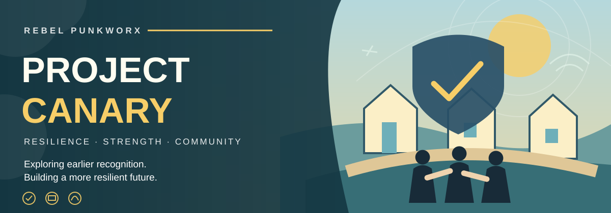
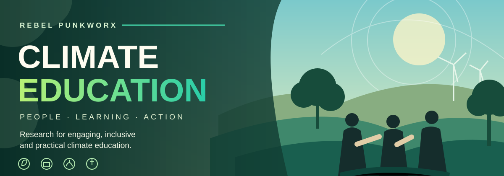
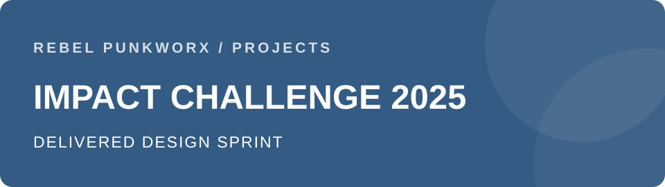
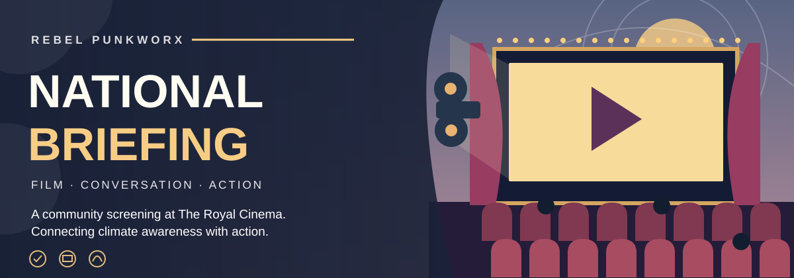

# Richard Haynes 👋

### Sustainability • Social Innovation • Open Collaboration • Technology for Good

I'm a sustainability and social innovation practitioner based in the West Midlands, UK. I bring together practical experience in housing, energy performance, community development and technology to make good ideas work in the real world.

My interests span better-performing homes, the circular economy, education, collaborative research and accessible digital tools.

## What I'm building

### 🏡 [B-HEM Solutions](https://bhemsolutions.co.uk)
**Better Homes • Lower Energy • Green Performance**

Domestic energy assessments, retrofit insight and practical support to help people understand and improve the performance of their homes. I'm also exploring digital tools, automation and energy data to make that work more useful and accessible.

### ♻️ [Rebel Punkworx](https://punkworx.org.uk)
A charity focused on creative repair, circular economy education and collaboration across generations. We work with students, educators and partners to turn real-world challenges into opportunities to learn, experiment and make a difference.

## The Rebel Punkworx Method

**Different challenges. One repeatable method. Real-world learning, tangible outcomes and something left behind.**

Across apparently different projects — a railway challenge, an old radio, a community climate problem or an organisational research question — a repeatable approach is emerging. The method creates the conditions for people to investigate real challenges, learn how to think about them and develop responses of their own.

| Step | Method | What it means |
| :--: | --- | --- |
| **1** | **Start with something real** | A railway challenge. An old radio. A community climate problem. An organisational research question. |
| **2** | **Reveal the system** | Who is affected? What behaviours matter? Where do materials come from? What incentives exist? What is not visible? |
| **3** | **Get close to the problem** | Meet users. Visit places. Handle objects. Interview people. Experience the environment. |
| **4** | **Teach ways of thinking** | Design thinking. Systems thinking. Empathy. Research. Experimentation. Creative problem-solving. |
| **5** | **Coach without taking over** | Provide structure, feedback, practitioners, networks and encouragement while preserving autonomy. |
| **6** | **Make something** | A prototype. Recommendation. Research report. Working object. New proposition. |
| **7** | **Put it in front of the real world** | Clients. Experts. Users. Practitioners. Communities. |
| **8** | **Leave something behind** | Knowledge. Documentation. Research. A prototype. A repaired object. An idea an organisation can pursue. |

**The principle:** This isn't a rigid formula or a claim that every project follows an identical path. It's an emerging, transferable way of working — grounded in real situations, with learning through doing, autonomy, external challenge and lasting value.

---

## Projects & impact

At Rebel Punkworx, we create opportunities for young people and communities to tackle real problems through research, design, repair and collaboration. The projects below distinguish **research and proposals** from **working prototypes** and **delivered events**.

### 🌦️ [Project Canary — anticipating crises before they escalate](https://punkworx-canary.netlify.app/)
**Stage:** Early-stage research and design proposition

How might communities recognise the weak signals of climate-related social stress before pressures become crises? Research explored connected indicators across weather, health, housing, food, energy and community intelligence, and possible routes from earlier recognition to action.

**Credits:** Research and report by Amina Hafiz (University of Birmingham); original problem and research brief by Richard Haynes / Rebel Punkworx; brief refinement and project mentoring by Debbie Smith, in collaboration with the Birmingham Institute for Sustainability and Climate Action (BISCA), University of Birmingham. This is not a deployed or validated warning system.

### 🎓 [Design & Climate Education Research](https://punkworx-climateeduation.netlify.app/)
**Stage:** Completed research; recommendations for future educational delivery

A University of Birmingham student consultancy project explored how climate education can move beyond passive awareness toward agency and practical action. Hridayana Lama Tamang's June 2026 research drew on literature and interviews with educators, young people and climate practitioners. Recommendations include hands-on learning, inclusive design, tangible outcomes and repeated engagement rather than one-off sessions.

### 🚆 [Impact Challenge 2025 — Chiltern Railways × University of Birmingham](https://punkworx-impactchallenge2025chiltern.netlify.app/)
**Stage:** Delivered student innovation challenge; concepts proposed

Rebel Punkworx designed and facilitated a week-long, multidisciplinary challenge exploring how rail could become a more attractive alternative to car travel while supporting Chiltern Railways' wider priorities. **100+ applications**, **six selected students**, field research at **three stations** and **12 qualitative interviews** informed the work. Students reframed the question around encouraging car-reliant commuters to consider rail, and developed propositions including heritage journeys, journey-planning assistance and inclusive ticketing. These were concepts, not deployed services.

### 📻 [The Perdio Radio Project](https://punkworx-perdio.netlify.app/)
**Stage:** Working connected-radio prototype; education and development work

A creative repair and learning project using radio as a practical vehicle for exploring electronics, digital technology and the circular economy. A working connected-radio prototype demonstrates three operating modes; the wider project explores opportunities for hands-on learning with schools.

### 🎬 [National Emergency Briefing — Rebel Punkworx community screening](https://punkworx-nebscreening.netlify.app/)
**Stage:** Delivered event; ongoing community connections

On **17 June 2026**, Rebel Punkworx convened a screening, discussion and Q&A at **The Royal Cinema, Sutton Coldfield**, using the National Emergency Briefing to connect climate awareness with local action. The cinema, operated by PDJ Cinemas, hosted and sponsored the event; Jay Birdi, Rebel Punkworx co-founder and founder of Open Box Procurement, provided important financial support. Fiona Joseph chaired the discussion, with local contributors and partners. A reconvening was planned for **17 December 2026** to examine what happened after the event.

**Evidence and attribution:** These summaries draw on Rebel Punkworx project case studies, research and its 2026 impact report. Student research and project partners are credited without implying institutional endorsement. Emerging ideas are not presented as tested products, and reported participation counts are not added together where they may overlap.

## Areas of interest

- Building performance, retrofit and decarbonisation
- Circular economy, repair and resourcefulness
- Social innovation, public services and community participation
- Open research, student collaboration and responsible attribution
- Linux, automation, digital tools and energy data

## Selected repositories

- [CommunityCapacity](https://github.com/DickyUK/CommunityCapacity)
- [TenantVoice](https://github.com/DickyUK/TenantVoice)
- [Auto-Annotated Portfolio](https://github.com/DickyUK/auto-annotated-portfolio)

Some project repositories are private while research, collaboration agreements or publication arrangements are being developed. Public project sites provide an introduction to the work.

## Let's connect

I'm interested in collaborating with people working on practical sustainability, repair, housing innovation, education and technology for social good.

🌐 [B-HEM Solutions](https://bhemsolutions.co.uk) · [Rebel Punkworx](https://punkworx.org.uk)
